# Taka · টাকা

A daily khata for hall life — what you ate, what you spent, who owes you, and how
much of the month is left.

**Built by Mazidul Islam Mahim** (মাজিদুল ইসলাম মাহিম).

<p align="center">
  
</p>


[](https://github.com/mahimmazidul/taka/releases/latest)
[](https://github.com/mahimmazidul/taka/actions/workflows/release.yml)

---

## Screenshots

Every screen, rendered from the real widgets by the golden test suite
(`flutter test test/golden_test.dart --update-goldens` → `docs/screenshots/`), and
refreshed whenever the UI changes. No mockups.

| Home | Home, the 1st — October's leftover still counted |
|---|---|
| 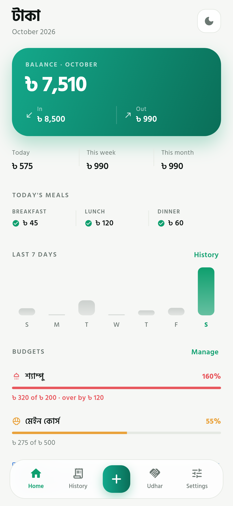 | 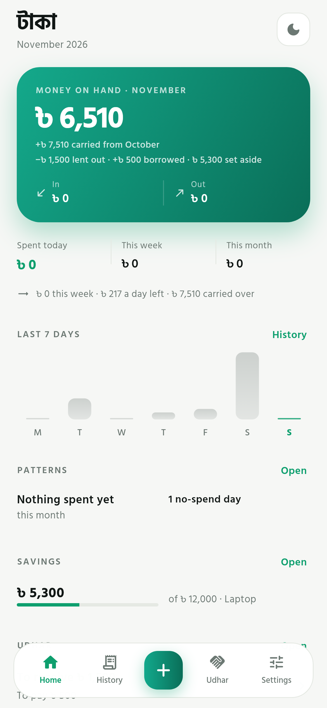 |

| Home (dark) |
|---|
| 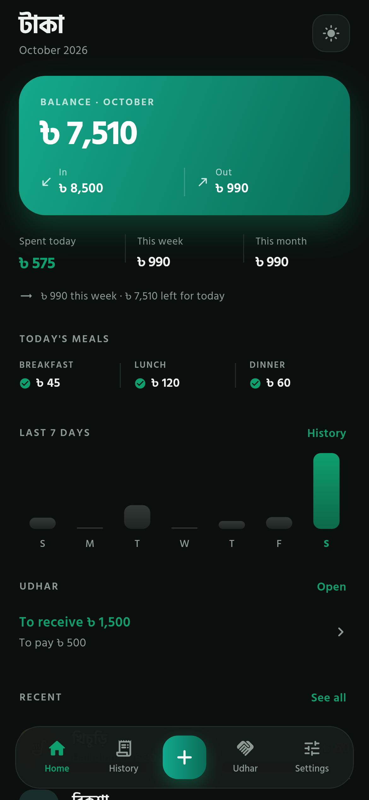 |

| Add entry | History |
|---|---|
| 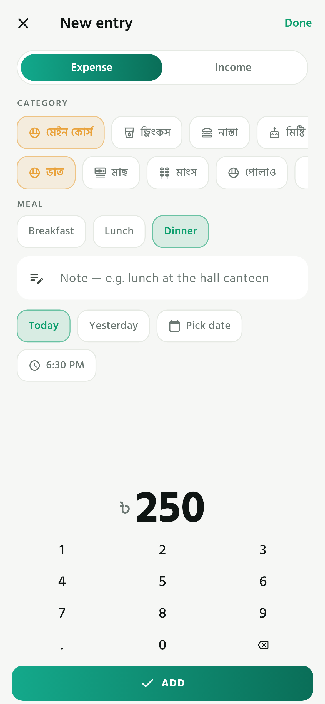 | 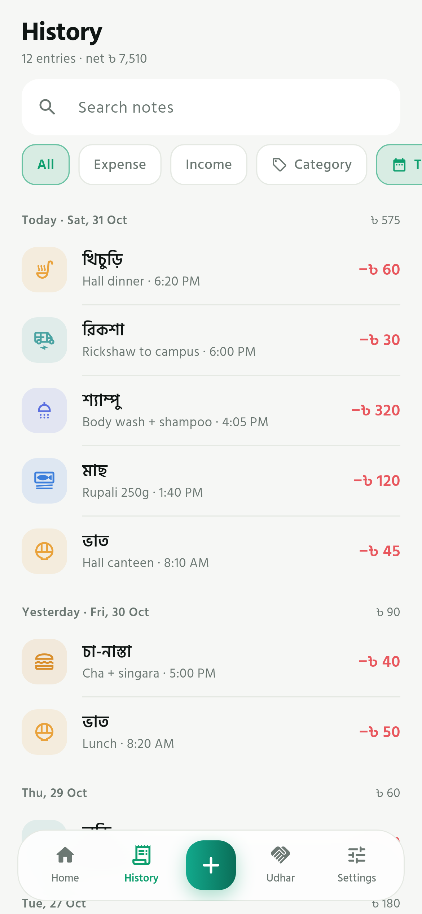 |

| Udhar | Budgets |
|---|---|
| 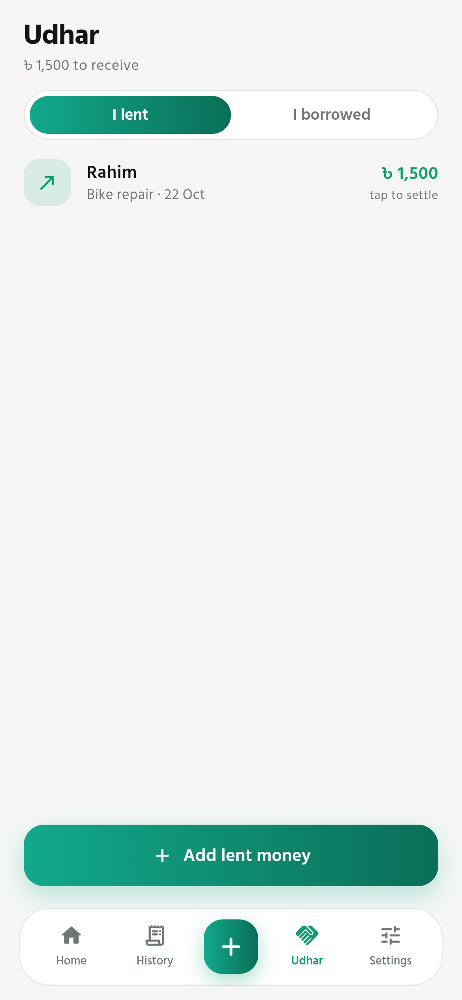 | 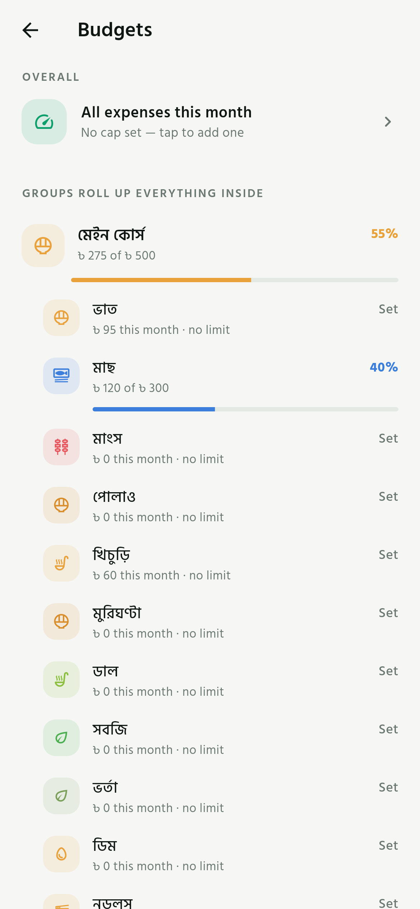 |

| Categories | Settings |
|---|---|
| 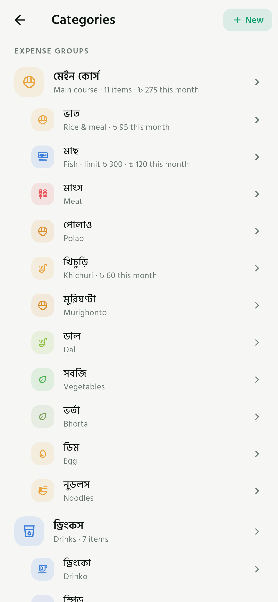 | 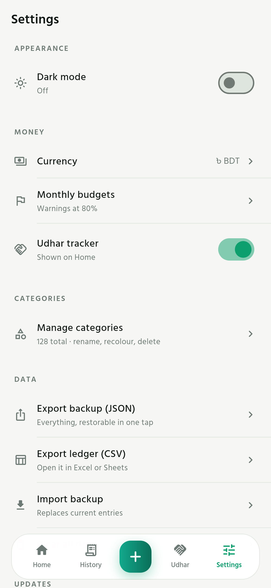 |

| Add entry (after saving) | Week breakdown |
|---|---|
| 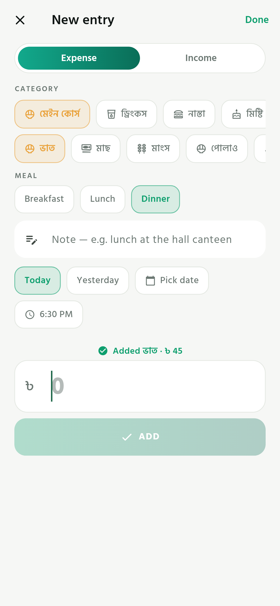 | 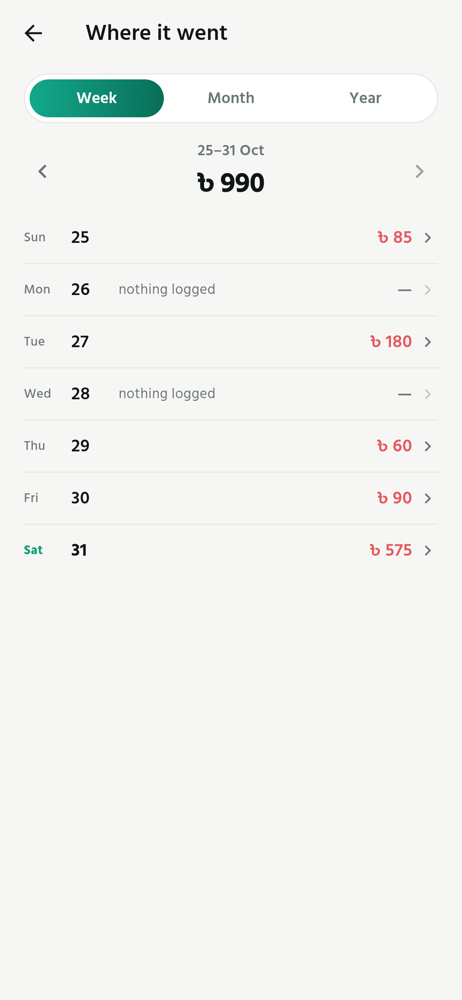 |

| Month breakdown | Year breakdown |
|---|---|
| 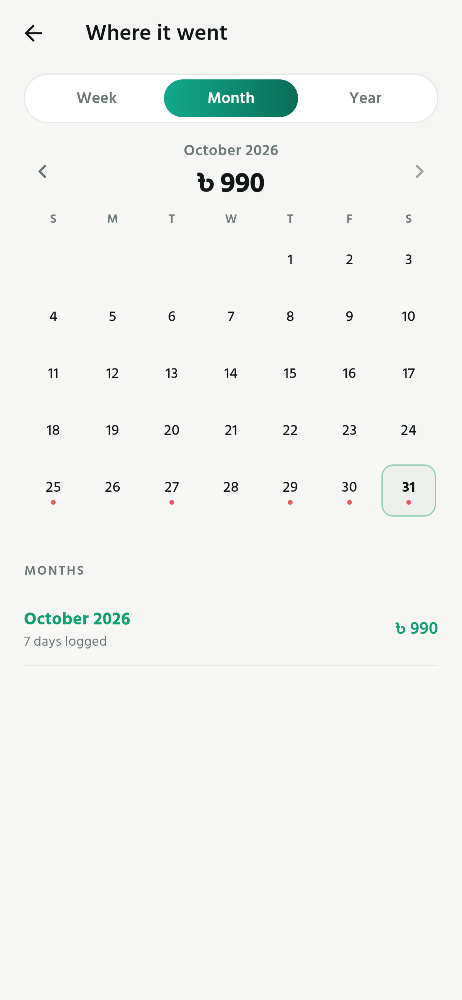 | 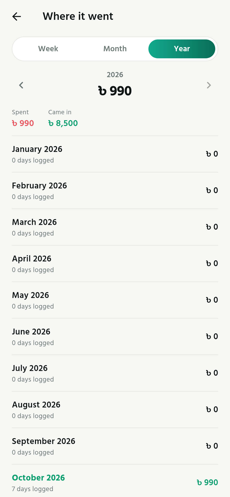 |

| Patterns | Dining out |
|---|---|
| 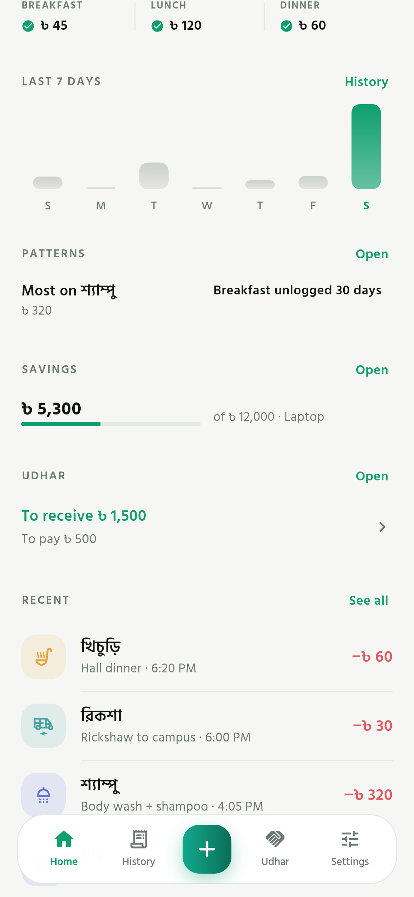 | 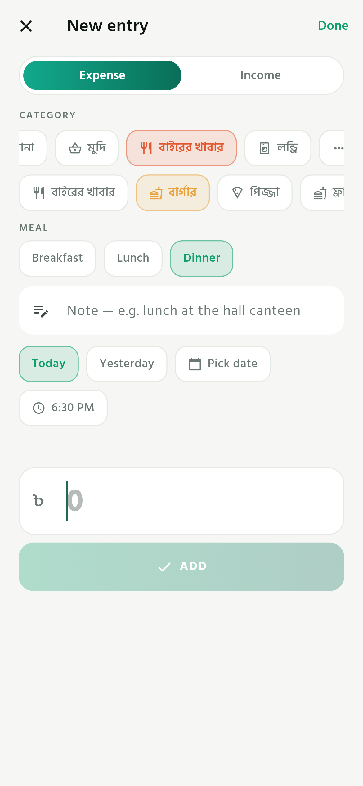 |

| Settings, updates and links | Licences |
|---|---|
| 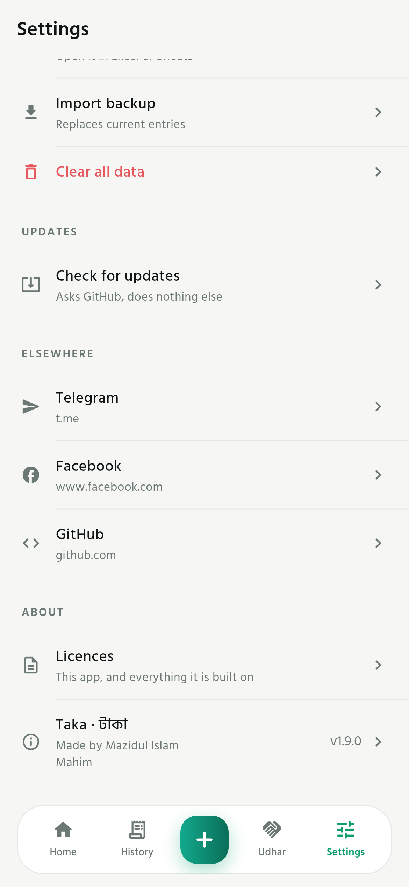 | 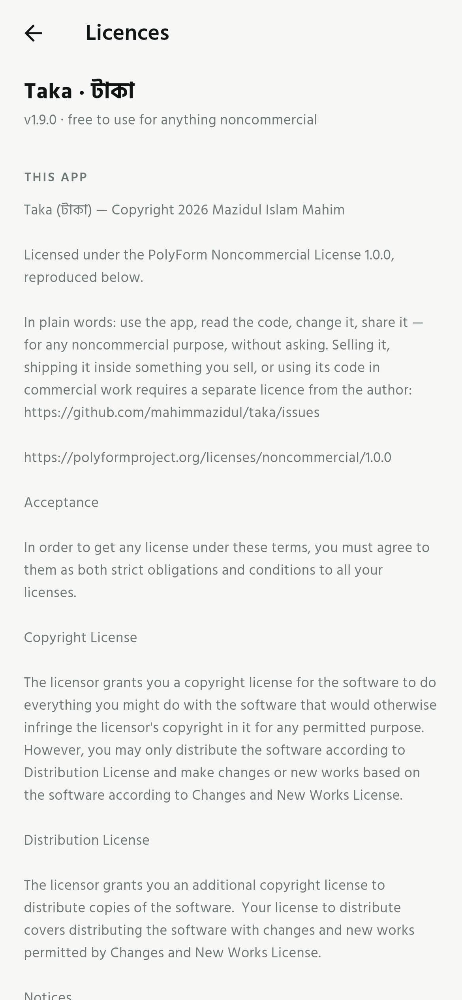 |

| Add entry (landscape) | Home (landscape) |
|---|---|
| 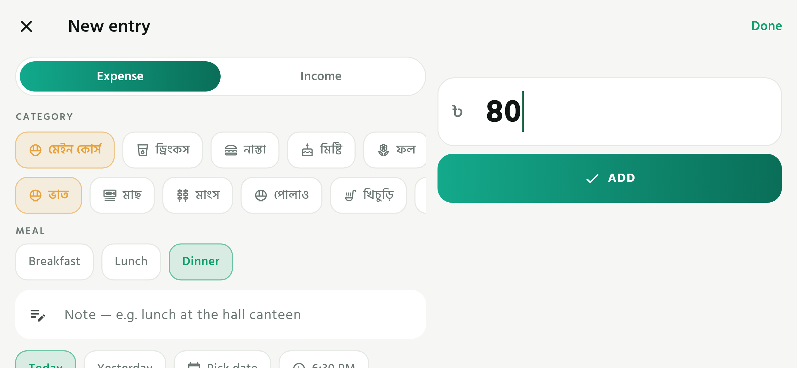 | 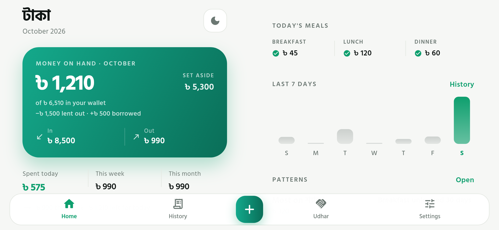 |

| About | Small phone (320 × 568) |
|---|---|
| 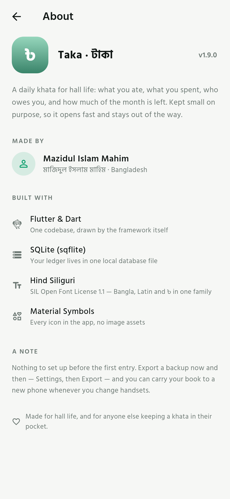 | 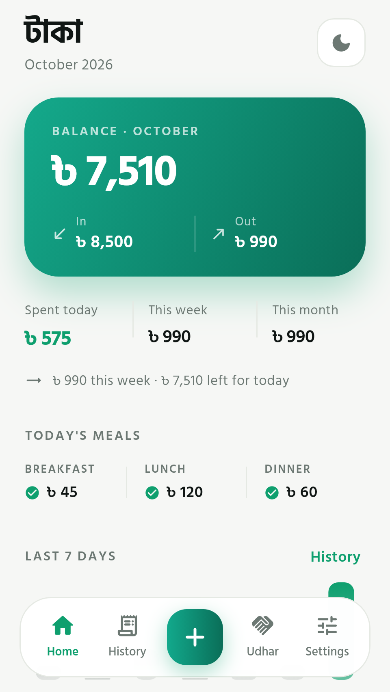 |

---

## The mark


A sage-to-eucalyptus gradient with the taka sign, rendered by
[`tool/make_icon.py`](tool/make_icon.py) — one script draws every Android density,
the adaptive icon and its monochrome layer, so the icon can never drift out of sync
with the app.

## Motion

Nothing snaps. Tabs glide between each other over 280 ms, pages fade and rise into
place over 320 ms, rows and chips press to 97% under the finger, amounts count
up instead of jumping, and Home's seven bars grow in one after another. Sized so it
still feels instant on a two-year-old phone.

---

## What it does

**Log an entry in one tap.** Open, tap ভাত, type the amount, save. The category
picker opens on the group you used last, so the common case never scrolls. A meal
tag (breakfast / lunch / dinner) is pre-picked from the clock and is one tap to
change — or to remove.

**Two levels of categories, seeded for hall life.** A group holds items, and an
item is what you log. Everything is renameable, recolourable and re-iconable, and
you can add your own groups or park a new item at the top level. An item added
inside a food group is food — it gets the breakfast/lunch/dinner chips and counts
in today's meals; a group itself never takes a meal tag.

| Group | Items |
|---|---|
| মেইন কোর্স · Main course | ভাত, মাছ, মাংস, পোলাও, খিচুড়ি, মুরিঘণ্টা, সবজি, ভর্তা, ডাল, ডিম |
| ড্রিংকস · Drinks | ড্রিংকো, স্পিড, মোজো, কোক / পেপসি, জুস, পানি, কফি |
| বাইরের খাবার · Dining out | বার্গার, পিজ্জা, ফ্রাই, শর্মা, ফ্রায়েড চিকেন, বিরিয়ানি, স্ট্রিট ফুড, সাধারণ |
| নাস্তা · Snacks | পরোটা, সমুচা, সিঙ্গারা, টোস্ট, বিস্কুট, চিপস, চা |
| মিষ্টি · Sweets | মিষ্টি, দই, আইসক্রিম, চকলেট |
| ফল · Fruits | কলা, আপেল, আম, পেয়ারা, পেঁপে, কমলা, তরমুজ |
| কসমেটিকস · Cosmetics & grooming | বডি ওয়াশ, ফেস ওয়াশ, শ্যাম্পু, সাবান, শেভিং ক্রিম, রেজর, ডিওডোরেন্ট, হেয়ার অয়েল, টুথপেস্ট |
| বই-খাতা · Books & stationery | শিট, নোটবুক, কলম, পেন্সিল, ইরেজার, ফটোকপি, খাতা, বই |
| কাপড় · Clothes | জামা, প্যান্ট, টি-শার্ট, জুতা, মোজা, আন্ডারগার্মেন্ট |
| স্বাস্থ্য · Health | ওষুধ, ডাক্তার, টেস্ট, জিম, সাপ্লিমেন্ট |
| হল খরচ · Hall & room | রুম ভাড়া, বিদ্যুৎ, পানি বিল, ওয়াইফাই, হল চাঁদা, মেস বিল |
| যাতায়াত · Transport | রিকশা, সিএনজি, বাস, ট্রেন, রাইড শেয়ার, পার্কিং |
| মোবাইল · Mobile & internet | রিচার্জ, ডেটা প্যাক, এক্সেসরিজ |
| বিনোদন · Entertainment | সিনেমা, গেম, সাবস্ক্রিপশন, ঘুরতে যাওয়া |
| উপহার ও পরিবার · Gifts & family | উপহার দেওয়া, দান, পরিবার |
| ফি ও জরিমানা · Fees & fines | পরীক্ষা ফি, লাইব্রেরি ফি, জরিমানা |

Plus two that sit on the top row themselves — **লন্ড্রি · Laundry**, **অন্যান্য ·
Other** — and six income sources (বাসা থেকে, টিউশন, বৃত্তি, ফ্রিল্যান্স, উপহার,
অন্যান্য).

**Search the whole ledger, in either script.** Type a note, or a category name in
English or Bangla — "rice" finds ভাত, and "ভাত" finds the entry whose note says
"canteen". While a search is open the date range steps aside, so nothing hides
behind a filter you forgot about.

**See where the month went.** A hero balance, **spent today** / week / month, a
one-line nudge (`৳ 990 this week · ৳ 250 a day left`), today's meals, a 7-day
chart that opens any of its days on tap, a Patterns teaser, udhar and the last
five entries. No limit, no progress bar — opening the
app should not feel like being told off.

**Budgets that roll up — in Settings, not on the way in.** Cap a whole group (food: ৳ 5,000) or a single item
(shampoo: ৳ 200). Amber at 80%, red and "over by ৳ x" past the limit.

**Patterns.** Built only from what has already been logged: where the money went
this month (biggest category first, as a share), how many days a meal went
unlogged — counted for food only, and worded as "not logged", never "you
skipped" — plus no-spend days, the average day, and the most expensive one.

**A month that ends does not wipe the slate — because the money is still in your
pocket.** Allowance arrives on the 30th, some of it is spent the same day, and on
the 1st the app used to show nothing left, as if the calendar had taken it. The
big number on Home is now *money on hand*: everything not yet spent, with a line
saying how much of it (`+৳ 7,510 carried from October`). The per-day nudge divides
that, the month breakdown shows what carried in, and a month with no income at all
still starts with last month's remainder.

**Udhar moves that number too, because it moves the pocket.** Money lent out is
not in your hand any more and money borrowed is, so *money on hand* is corrected
by both — with a line saying which: `−৳ 1,500 lent out · +৳ 500 borrowed`.
Settling either one puts the same amount back. This is a correction to the
pocket, not an expense: income and spending stay what they were.

Limits are a separate idea and stay separate: a budget caps a category for the
month and never eats the money you already have.

**History that answers questions.** Grouped by day with per-day totals, live note
search, expense/income filter, a group filter that covers everything inside it,
and date ranges. Tap to edit, long-press to delete.

**One row that checks for a new release.** Settings → *Check for updates* asks
GitHub once, when you tap it, and compares versions numerically. Tap again on a
newer version to open the download page. Offline it says it could not check and
leaves you alone.

**Udhar.** Money lent and borrowed per person, one tap to settle.

**Backups you can pick up on another phone.** JSON export / import and CSV for
Excel or Sheets.

---

## Install

Grab the newest file from [Releases](https://github.com/mahimmazidul/taka/releases):

| File | Use it for |
|---|---|
| `taka-<version>-arm64.apk` | **Almost every phone** made since ~2016 (64-bit ARM) |
| `taka-<version>-arm32.apk` | Very old or very cheap 32-bit devices |
| `taka-<version>-x86_64.apk` | Emulators only |
| `taka-<version>.aab` | Publishing to a store — not something you install by hand |

Same features, same UI, same code — the APKs only differ in which CPU build they
carry. Android will ask you to allow installs from unknown sources; that is
expected for an app that isn't on the Play Store.

**Updating an installed copy.** Two rules, and the phone will take every later
release in place, keeping your ledger:

1. **Use the same file every time.** Pick `arm64` (or `arm32` if that is what you
   installed) and keep using it. The split APKs carry different internal version
   numbers, so installing the 32-bit build over the 64-bit one is seen as a
   *downgrade* and refused — that is the "package conflict" message.
2. **Same signature.** Releases up to v1.4.0 were signed with a throwaway debug
   key; from v1.5.0 they are signed with one fixed release key kept outside the
   repository. Android will not replace an app signed by a different key, so this
   is the one time an update needs an uninstall first — **export a backup
   (Settings → Export) before you do, and import it afterwards.** Every release
   after that installs straight over the top.

Nothing else is needed: the database lives in the app's own storage and an
in-place update leaves it alone — no re-login, no re-import, no lost month.

### About the download size

One universal APK bundles three CPU builds — arm64, arm32 and x86 — so v1.0 was
53 MB. Split per ABI (and with the Dart debug info stripped out of the shipped
binary), the same app with the same features and UI is:

| File | Size | What is inside |
|---|---|---|
| `taka-1.3.0-arm64.apk` | 17.0 MB | one CPU build, 1.2 MB of it Hind Siliguri |
| `taka-1.3.0-arm32.apk` | 14.4 MB | the same for very old phones |
| `taka-1.3.0.aab` | 46.7 MB | all three plus what a store needs — Google Play serves ~17 MB from it |

What is left is mostly the Flutter engine itself (11.8 MB `libflutter.so`) and the
compiled Dart (`libapp.so`, ~5 MB). Regular R8 resource shrinking would win a few
hundred kilobytes and cost readable stack traces; the symbol files are uploaded as a
separate build artifact instead, so a crash report can still be symbolicated.

## Run it yourself

```bash
git clone https://github.com/mahimmazidul/taka.git
cd taka
flutter pub get
flutter run               # phone or emulator attached
```

Quality gates used in CI:

```bash
flutter analyze                               # 0 issues
flutter test --concurrency=1                  # 77 tests
dart format --output=none --set-exit-if-changed lib test
```

## Release flow

`git tag v1.3.0 && git push origin v1.3.0` →
[`.github/workflows/release.yml`](.github/workflows/release.yml) runs formatting,
analysis and the tests, builds one APK per CPU plus an app bundle, keeps them as
workflow artifacts and attaches them to a GitHub Release. Pushes to `main` build
the same artifacts without publishing a release.

The APK is signed with Flutter's debug key so CI can always produce an installable
file. For a store-ready build, add your keystore and `android/key.properties`, then
point `signingConfigs.release` at it.

---

## How it is built

```
lib/
├── main.dart                  open the database, load state, run the app
├── app.dart                   MaterialApp, theme mode, system UI
├── core/
│   ├── app_theme.dart         palette, Hind Siliguri text theme, light/dark
│   ├── motion.dart            Pressable, Reveal, AnimatedMoney, page route
│   ├── clock.dart             the one place DateTime.now() lives
│   └── app_info.dart          name, version, author — read by About
├── constants/
│   ├── default_categories.dart    15 groups, 3 standalone items, 6 income sources
│   ├── default_subcategories.dart the 90+ items inside those groups
│   └── category_icons.dart        70 icon keys, the picker subset, colour swatches
├── models/                    transaction_entry (+meal), app_category (+parent),
│                              udhar_entry, app_settings, meal_slot,
│                              period_totals, budget_progress, day_group
├── db/                        database.dart (schema v6, migrations, additive
│                              seeding) and one repository per table
├── store/                     app_state.dart (ChangeNotifier) plus extensions:
│                              settings_actions, category_actions, udhar_actions,
│                              data_actions
├── utils/                     format_currency, date_helpers, budget_calculator,
│                              currency_catalog, export_data, color_hex, id,
│                              insights, money_input_formatter
├── services/                  update_checker (one request to the releases API)
├── components/                category_picker, hero_balance, stat_strip, week_bars,
│                              budget_line, entry_row, category_tile, segmented,
│                              amount_keypad, app_sheet, primary_button,
│                              settings_row, section_title, empty_state
└── screens/                   app_shell, home, add_entry, history, udhar, budgets,
                               categories, category_editor_sheet, insights,
                               settings, about
```

Seven runtime dependencies, all of them boring: `sqflite` (local SQLite), `path`,
`path_provider` (where the backup is written), `share_plus` 13 (hand a file to
Android's share sheet), `file_picker` 13 (pick a JSON file to restore), `http`
(the one update check) and `url_launcher` (hand a link to the browser). No
state-management package, no chart package, no analytics.

The app needs the network for exactly one thing — *Check for updates* — and never
on its own. Nothing is uploaded, and every screen works with the radio off.

### Data model (SQLite `taka.db`, schema v7)

```sql
categories(id, name, name_bn, icon, color, kind, budget_minor,
           sort_order, parent_id, is_group, food, also_groups)
transactions(id, type, amount_minor, category_id, note,
             occurred_at, created_at, updated_at, meal)
udhar_entries(id, type, person, amount_minor, note, occurred_at,
              returned, returned_at, created_at, updated_at)
settings(key, value)
```

- **Money is an integer count of paisa.** `0.1 + 0.2` drift is impossible;
  `৳ 1,250.50` exists only at the UI edge (`utils/format_currency.dart`).
- **Timestamps are epoch milliseconds**, so today/week/month are indexed range
  queries, and the whole ledger filters in memory for instant search.
- **A group is a row with `is_group = '1'`**; its items point at it through
  `parent_id`, so a group budget and a group filter are a rollup, not a second
  table.
- **Income sources are categories** with `kind = 'income'`.
- **Weeks start Sunday** (Bangladesh convention) — one constant in `date_helpers.dart`.
- **"Now" comes from `AppClock`**, never from `DateTime.now()` directly. Tests point
  it at a frozen instant, which is why the screenshots are byte-stable.

### Upgrades never eat your ledger

Three deliberate rules, because losing last month's khata over an app update would
be unforgivable:

1. **Category ids are never renamed.** When the flat list became groups, ভাত kept
   `id = 'rice'`; it only gained `parent_id = 'g_main'`. Every old transaction still
   points at the right category.
2. **Column additions run before seeding.** Every later step writes a full seed
   row, so a v2 file that jumped straight to v4 tried to insert a column that did
   not exist yet. The order is now column, then data.
3. **Seeding is additive and runs on every open.** Any seeded category missing from
   the database is inserted; nothing that already exists is ever overwritten — your
   names, colours and limits win.
4. **Only signatures decide whether an update installs.** Release builds are
   signed with one key kept outside the repository (`android/key.properties`
   locally, `TAKA_*` secrets in CI, see `tool/signing/SIGNING.md`), so a new APK
   replaces the old one in place and the database in app storage is untouched. A
   build signed with a different key is the one thing Android will refuse.
5. **Migrations are idempotent.** Columns are added only if absent, so an
   interrupted upgrade cannot leave a database that refuses to open.

`test/database_test.dart` builds a v2 database by hand, reopens it with the current
code and asserts the old entry, its category and its budget all survived — now
through five upgrades, v2 → v7.

### Tests

105 tests, all offline (40 logic, insight and store rules, 25 database, 12 screen, 21 golden,
plus the fast-food and carry-over rules):

| File | Covers |
|---|---|
| `test/logic_test.dart` | money formatting, exact keypad→paisa conversion, date helpers, budget thresholds, labels |
| `test/database_test.dart` | the real schema and SQL on SQLite: seeds and the category tree, CRUD, totals, per-day buckets, filters, category reassignment and group deletion, udhar settlement, settings, backup round-trip, CSV, and both migrations (v2 → v4, and the v4 duplicate merge) |
| `test/period_stats_test.dart` | the day / week / month / year maths behind the breakdowns: empty days kept, income kept apart from spending, the month list starting where the history starts, a day's entries newest first |
| `test/food_logic_test.dart` | the meal rule: which categories may take a meal, that a non-food entry never lands in a meal total even if an old row stored one, why noodles and egg exist twice, and that `today` really resets at midnight |
| `test/insights_test.dart` | the Patterns maths: a meal day is missed only when nothing was logged for it, today counts only for meals already past, a non-food entry never counts, ranking, rhythm, and that 1.10.0 is newer than 1.9.0 |
| `test/carry_search_test.dart` | the real case — money in on 30 October, spent the same day, still there on 1 November; two months of leftovers both carrying; that a resume on the same day does not reload but a new day does; udhar moving money on hand and settling reversing it; and search: by note in any month, by English category name, by Bangla category name |
| `test/screens_test.dart` | the whole app at 320 / 360 / 414 / 768 widths **and in landscape**, 1.3× text scale, tab switching, adding an entry end-to-end, the meal row disappearing for a face wash, the period breakdowns and their day sheet, dark-mode toggle |
| `test/golden_test.dart` | every screenshot in this README |

---

## Licence

**Use the app.** Free, for anyone, forever — no account, no ads, no payment.

**Use the code.** Also free, for anything noncommercial: read it, learn from it,
change it, fork it, ship your own build to your friends, put it on a shelf. You do
not have to ask.

**Commercial use needs a licence from me.** Selling the app, bundling it, using its
code in something you sell, or shipping it in a commercial product: open an issue
on the repo and we will talk. I am not against it; I want to be asked.

This is the [PolyForm Noncommercial License 1.0.0](https://polyformproject.org/licenses/noncommercial/1.0.0),
full text in [`LICENSE`](LICENSE). It is **not** an OSI "open source" licence, and
that is deliberate: open source by that definition includes selling it. What you get
here is source-available, noncommercial — the code is public, the commercial rights
are not.

Inside the app, Settings → **Licences** prints those terms and the font's SIL Open
Font License, and links to the BSD-style licences of Flutter, sqflite, http and
url_launcher. The Hind Siliguri font ships under the SIL OFL 1.1 and keeps that
licence regardless of the code's.

## Credits

- **Mazidul Islam Mahim** (মাজিদুল ইসলাম মাহিম) — idea, requirements, and the refusal
  to accept a boxy app or an emoji.
- **Hind Siliguri** (Indian Type Foundry / Google Fonts) — SIL Open Font License 1.1.
  Bundled in `assets/fonts/` so Bangla, Latin and ৳ all render in one family.
- Icons: Material Symbols via `flutter/material`.

## Changelog

- **v1.9.0** — ভর্তা joins the main course, and items you add yourself finally
  count as meals. A category created under Main course (or Snacks, Drinks, Sweets,
  Fruit, Dining out) used to be stored as *not food*: no meal chips on the Add
  screen and no line in today's meals. The edible groups are flagged now, new items
  inherit it, and schema v7 repairs items already added by hand.

- **v1.8.0** — the project gets a licence. PolyForm Noncommercial 1.0.0: free to
  use, read, change and share for anything noncommercial; commercial use or reuse
  of the code needs a separate licence from the author. Settings → **Licences**
  prints the terms, the font's OFL and a link to the dependency licences.

- **v1.7.0** — udhar now counts in **money on hand**: lent money is money that has
  left the pocket, borrowed money is money that has arrived, and settling either
  reverses it. The card says so under the balance. Spending and income totals are
  untouched — udhar is still a pending ledger, not an expense.

- **v1.6.0** — the money follows you across the month boundary. Home's big number
  is **money on hand** (last month's remainder + this month's income − this month's
  spending) with a line saying what carried, the month breakdown shows what carried
  in, and the per-day nudge uses all of it. The app also reloads itself just after
  midnight and when it comes back to the foreground, so "today" is never yesterday.
  All of it uses one clock (`AppClock`), not two. Plus মুরিঘণ্টা in the main course.

- **v1.5.1** — Settings → *Elsewhere* now actually points somewhere: Telegram
  (@dumbhuman), Facebook and GitHub. Nothing else changed.

- **v1.5.0** — the month starts where the last one ended. Leftover money carries
  into the new month and the per-day nudge divides what is really left. Search
  now reaches every entry, by note or by category name in English or Bangla.
  **Patterns** answers the questions the ledger already holds: where the money
  went, which meals went unlogged, how many days cost nothing. **Dining out** is a
  group of fast food instead of one lump. Tapping any day in the 7-day chart opens
  that day. The meal tag follows the clock again. Settings gains a one-tap
  **Check for updates** against GitHub releases, and links to the author. Release
  builds are signed with a key kept outside the repository, so an update installs
  over the old app and your data stays.

- **v1.4.0** — the numbers have somewhere to go. Tapping **Spent today / This
  week / This month** on Home opens a breakdown: week gives all seven days with
  the amount for each (empty days included), month gives a calendar where any
  date opens that day's entries plus every month since you started using the app,
  and year gives the whole year month by month. The hand-built keypad is gone —
  the amount is a normal field with the phone's own numeric keyboard, so the keys
  are the size the OS says, and the cursor stays in it after saving so
  type–tap–type–tap works. Egg and noodles are no longer two categories each: one
  row, one total, listed under both groups (`also_groups`, schema v5), with the
  duplicates from 1.3.0 merged back on upgrade. Two migration-order bugs found and
  fixed by the tests, again.
- **v1.3.0** — the correctness release. Meal tags are now a property of the
  category (`food`), not a guess: a face wash can no longer be logged as
  breakfast, and the meal strip only counts food money. Added noodles and egg to
  snacks (noodles also to main course). The entry screen stays open after saving
  with an inline `Added ভাত · ৳45` strip, so ভাত + মাছ + a drink is three taps
  each and one Done; Save moved into the keypad's bottom row. Home lost the
  budgets block and gained `Spent today` plus a one-line weekly nudge. Launch no
  longer flashes black (the Android window and Flutter's first frame share the
  same colour, and the database read happens after the first frame). Landscape
  reflows: two columns on Home, form-and-pad side by side on the entry screen,
  shorter tab bar, capped line lengths. Scrolling got lighter — the tab bar blur
  is gone and History builds one list item per row instead of one per day.
  Settings and About values sit flush right. Ten new logic tests, including a
  v2 → v4 migration test.
- **v1.2.0** — new launcher icon (rendered from `tool/make_icon.py`), animated tab
  changes and richer page transitions, credit corrected to Mazidul Islam Mahim.
- **v1.1.0** — two-level categories (groups + items, 90+ seeded items), meal tags
  with a "today's meals" strip, group budgets and group filters, additive seeding
  and a safe v2 → v3 migration, About screen with the author credit, and CI now
  ships one APK per CPU plus an app bundle instead of one 50 MB universal APK.
- **v1.0.1** — budget rows no longer printed the category twice; budgets and
  categories joined the screenshot suite; time routed through `AppClock`.
- **v1.0.0** — first full build: dashboard, add/edit, history with filters, udhar,
  budgets, category manager, JSON/CSV backup, dark mode, CI release pipeline.
